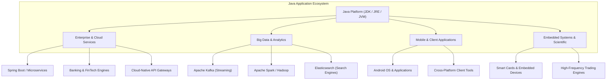

# What is Java? Its Role in Modern Software Development

---

## 1. What is Java?

**Java** is a high-level, class-based, object-oriented, general-purpose programming language designed to have as few implementation dependencies as possible. Built around the foundational philosophy of **"Write Once, Run Anywhere" (WORA)**, Java compiles source code into intermediate bytecode rather than platform-specific machine code. This bytecode executes on any system equipped with a compatible **Java Virtual Machine (JVM)**.

### Historical Evolution of Java

Java was created by **James Gosling** and his team at **Sun Microsystems** (later acquired by Oracle Corporation) in 1991, initially dubbed *Project Green* and named *Oak*, before being officially released to the public in 1995 as **Java 1.0**.

#### Key Milestones Across Java History:

- **Java 1.0 (1995–1996)**: Introduced the core language syntax, applets for the early web, and the basic Java Virtual Machine (JVM).
- **Java 2 / J2SE 1.2 (1998)**: Re-architected into editions (J2SE, J2EE for enterprise, J2ME for mobile/embedded) and introduced the Java Collections Framework and Swing GUI.
- **Java 5 (2004)**: Major language leap introducing Generics, Annotations, Enums, Autoboxing/Unboxing, enhanced `for-each` loops, and the `java.util.concurrent` package.
- **Java 8 (2014, LTS)**: Landmark milestone bringing functional programming paradigms to Java: Lambda Expressions, the Stream API, the `Optional` class, default methods in interfaces, and the new Date/Time API (`java.time`).
- **Java 9 & The Modern 6-Month Cadence (2017–2018)**: Shifted from multi-year releases to a predictable 6-month release cadence with Long-Term Support (LTS) versions released every two years. Introduced Project Jigsaw (Java Platform Module System).
- **Java 11 (2018, LTS)**: Introduced `var` for lambda parameters, native HTTP Client API (`java.net.http`), and improved container/cloud awareness.
- **Java 17 (2021, LTS)**: Brought Sealed Classes, Pattern Matching for `switch` (preview), Records for immutable data carriers, text blocks, and strong encapsulation of JDK internals.
- **Java 21 (2023, LTS)**: Landmark concurrency upgrade introducing **Virtual Threads** (Project Loom) for lightweight high-throughput I/O, Record Patterns, Sequenced Collections, and Key Encapsulation Mechanisms.
- **Java 25 (2025 LTS roadmap)**: Ongoing advancement building on Project Valhalla (primitive/value classes), Project Amber (productivity syntax enhancements), and Project Panama (efficient native interop).

---

## 2. Key Features of Java with Examples

### 1. Platform Independence ("Write Once, Run Anywhere")
Java source code (`.java`) compiles into architectural-neutral bytecode (`.class`). The JVM translates this bytecode into native machine instructions via the Just-In-Time (JIT) compiler.

```text
[Java Source Code (.java)] 
            │
      (javac compiler)
            ▼
   [Bytecode (.class)]
            │
   ┌────────┴────────────────────────┬────────────────────────┐
   ▼                                 ▼                        ▼
[Windows JVM]                  [Linux JVM]               [macOS JVM]
   │                                 │                        │
   ▼                                 ▼                        ▼
Windows Native Machine Code   Linux Native Machine Code  macOS Native Machine Code
```

### 2. Object-Oriented Programming (OOP)
Java enforces modular, reusable, and maintainable software architecture using the four pillars of OOP:
- **Encapsulation**: Bundling state and methods within classes while restricting direct variable access.
- **Inheritance**: Deriving specialized subclasses from base classes.
- **Polymorphism**: Allowing methods to take multiple forms (method overloading and overriding).
- **Abstraction**: Hiding internal implementation details using abstract classes and interfaces.

```java
// Example: Encapsulation and Interface Abstraction
public interface PaymentProcessor {
    boolean processPayment(double amount);
}

public class StripePaymentProcessor implements PaymentProcessor {
    private final String apiKey;

    public StripePaymentProcessor(String apiKey) {
        this.apiKey = apiKey;
    }

    @Override
    public boolean processPayment(double amount) {
        // Business logic to execute transaction
        System.out.println("Processing $" + amount + " via Stripe");
        return true;
    }
}
```

### 3. Robustness & Automatic Memory Management
Java eliminates explicit pointer arithmetic and memory deallocation errors (such as memory leaks or double-free bugs) through automatic **Garbage Collection (GC)**. Strong type checking at compile-time and run-time, along with strict Exception Handling, guarantees system stability.

```java
try {
    int result = 100 / divisor;
} catch (ArithmeticException ex) {
    System.err.println("Safe handling of division by zero: " + ex.getMessage());
}
```

### 4. Modern Language Features (Records & Streams)
Modern Java versions combine concise syntax with functional paradigms:

```java
import java.util.List;

// Record: Immutable data-carrier without boilerplate getters, equals, or hashCode
public record Developer(String name, String role, int experienceYears) {}

public class StreamDemo {
    public static void main(String[] args) {
        List<Developer> team = List.of(
            new Developer("Alice", "Backend Engineer", 6),
            new Developer("Bob", "Frontend Engineer", 3),
            new Developer("Charlie", "Cloud Architect", 10)
        );

        // Declarative data filtering with Stream API
        List<String> seniorEngineers = team.stream()
            .filter(dev -> dev.experienceYears() >= 5)
            .map(Developer::name)
            .toList();

        System.out.println("Senior Engineers: " + seniorEngineers);
    }
}
```

### 5. High-Throughput Concurrency (Virtual Threads in Java 21+)
Project Loom introduced lightweight Virtual Threads, reducing thread creation overhead from megabytes of operating-system stack space to minimal heap memory:

```java
// Running tasks concurrently with high scalability
try (var executor = java.util.concurrent.Executors.newVirtualThreadPerTaskExecutor()) {
    executor.submit(() -> System.out.println("Handling request on virtual thread"));
}
```

---

## 3. Real-World Applications of Java

Java powers critical backbones across industries:

1. **Enterprise Banking and Financial Services**:
   - Used by top tier-1 investment banks (Goldman Sachs, JPMorgan Chase, Citigroup) for algorithmic trading platforms, transaction settlement ledgers, and fraud detection engines.
   - Frameworks: Spring Boot, Jakarta EE, Quarkus, Micronaut.

2. **Big Data Processing & Distributed Systems**:
   - Core big-data technologies are written in or designed for Java and the JVM.
   - Examples: **Apache Kafka** (high-throughput event streaming), **Apache Spark**, **Apache Hadoop**, **Apache Flink**, and **Elasticsearch**.

3. **Android Mobile Application Development**:
   - Millions of mobile apps rely on Java or share the underlying Android runtime architecture alongside Kotlin.

4. **Cloud-Native Microservices & Web APIs**:
   - Scalable, containerized backends deployed across Kubernetes, AWS, GCP, and Azure.

5. **Scientific Computing and High-Frequency Trading**:
   - Low-latency frameworks like the LMAX Disruptor leverage JVM memory models for microsecond-level latency.

---

## 4. Architectural Diagram: Java Application Ecosystem



### Text / ASCII Application Map

```text
+-------------------------------------------------------------------------+
|                        JAVA RUNTIME PLATFORM (JVM)                      |
+--------------------+--------------------+-------------------------------+
          |                   |                   |               |
          v                   v                   v               v
  [ Enterprise / Web ]   [ Big Data & Cloud ]  [ Android / Mobile ] [ Embedded / FinTech ]
  - Spring Boot          - Apache Kafka        - Android SDK        - Smart Cards / SIMs
  - Jakarta EE           - Apache Spark        - Native Apps        - Algorithmic Trading
  - Microservices        - Elasticsearch       - Client Tools       - Medical Devices
+--------------------+--------------------+-------------------------------+
```

---

## 5. Summary

Java remains one of the world's most widely adopted programming languages due to its unmatched stability, backward compatibility, platform independence, and continuous modernization (from Java 1.0 to modern LTS releases like Java 21 and upcoming Java 25). Its robust virtual machine, powerful ecosystem, and vibrant community ensure its role as a premier enterprise development technology for decades to come.
